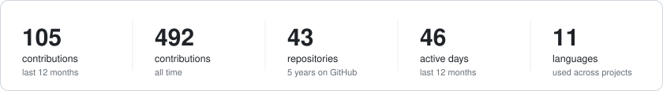
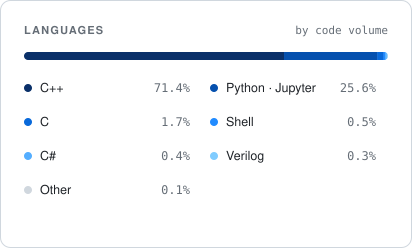
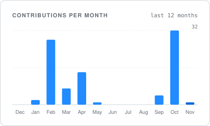

Final-year Computer Engineering student at the **Universidad de La Laguna**. 
I enjoy turning hard problems into efficient, well-tested code.

&nbsp;&nbsp;
<!-- Añadir aquí LinkedIn / email:

-->

 

### About

- 🎓 **Studying** — B.Sc. Computer Engineering, Universidad de La Laguna (4th year)
- 🔬 **Thesis** — Generality analysis of multi-objective hyper-heuristics
- 🧠 **Focus** — Algorithm design & analysis · optimization · intelligent systems · theory of computation
- 🛠️ **Building** — Turing machine & pushdown automata simulators (C++) · Unity physics & event systems (C#)
- 🗄️ **Also into** — Relational data modelling with PostgreSQL · containerised environments with Docker

### Tech stack

  

  

### Metrics

<picture>
  <source media="(prefers-color-scheme: dark)" srcset="assets/overview-dark.svg" />
  
</picture>

<picture>
  <source media="(prefers-color-scheme: dark)" srcset="assets/languages-dark.svg" />
  
</picture>
<picture>
  <source media="(prefers-color-scheme: dark)" srcset="assets/activity-dark.svg" />
  
</picture>

<picture>
  <source media="(prefers-color-scheme: dark)" srcset="https://raw.githubusercontent.com/Ramonizq/Ramonizq/output/snake-dark.svg" />
  
</picture>

  Metrics include private repositories · refreshed daily by GitHub Actions · last update <!--UPDATED:START-->08 Nov 2026<!--UPDATED:END-->

